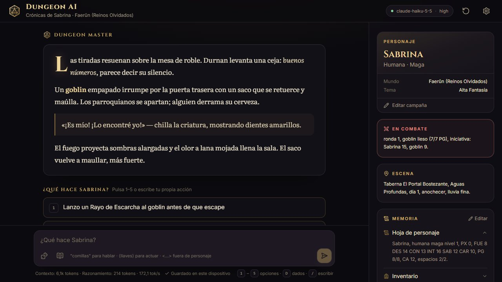
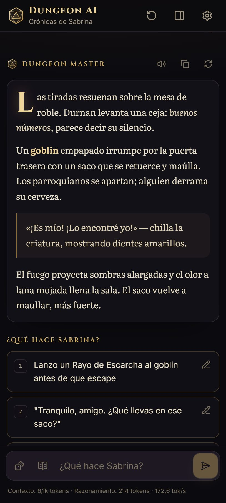

<div align="center">


# Dungeon AI

**Tu Dungeon Master con IA. Una aventura de rol en español que se escribe contigo.**

Sin mesa, sin fichas que rellenar y sin esperar turnos: describes lo que haces, eliges entre las opciones que propone el DM y tiras los dados. La historia recuerda cada escena y continúa donde la dejaste.

[](https://cdcb-dungeon-ai.vercel.app)
[](https://github.com/DavidCDCB/DungeonAI)


</div>

<p align="center">
  <a href="https://cdcb-dungeon-ai.vercel.app">
    
  </a>
</p>

> **Juega gratis y sin crear una cuenta en Dungeon AI.** Conectas tu propia clave de un proveedor compatible con OpenAI —OpenCode, OpenAI, OpenRouter, Groq, DeepSeek, Ollama, LM Studio o uno personalizado— y la partida se queda en tu navegador.

## ¿Qué es Dungeon AI?

Dungeon AI es un juego de rol de fantasía para el navegador. Un **Dungeon Master de IA** narra la aventura en español, reacciona a tus decisiones, pide tiradas cuando la escena lo merece y mantiene un estado del mundo con la escena, el combate, la hoja de personaje, el inventario, las misiones y los PNJ.

Tú llevas al personaje y decides el rumbo; la app se encarga de la narración, los dados, la continuidad y la presentación. Está pensada para partidas largas y para jugar cómodamente tanto en el escritorio como en el móvil, incluso instalada como aplicación.

## Todo lo que necesitas para jugar

| Función | Qué hace |
|---|---|
| 📖 **Narración en vivo** | El texto del DM aparece mientras se escribe, con un indicador de fase, tiempo y tokens de razonamiento. Puedes detener el turno cuando quieras. |
| 🎲 **Dados de verdad** | El DM pide la tirada y la app crea el botón: `1d20 + 5`, ventaja, desventaja, d4–d100, varios grupos y descarte del menor. Críticos y pifias resaltados. |
| 🧠 **Memoria persistente** | La escena, el combate, la hoja, el dinero, las condiciones, las misiones y los PNJ se guardan como estado y un **Cronista de estado** lo actualiza tras cada narración. |
| 🕹️ **Decisiones con un toque** | Cinco opciones numeradas (atajos `1`–`5`), una opción 🃏 de comodín y la posibilidad de editar cualquier opción antes de enviarla. |
| 🗣️ **Lectura y voz** | Voz del navegador con velocidad y lectura automática, tipografía de libro y letra capital en cada escena. Sin servidores TTS ni claves extra. |
| 📱 **App instalable** | PWA que se instala desde el navegador y abre sin conexión. En el móvil, el compositor se adapta al teclado y la lectura está pensada para pantallas estrechas. |
| 🔌 **Tu modelo, tus reglas** | Proveedores OpenAI-compatibles, ventana de contexto de 32k a 1M, detección automática y reintentos según lo que soporte el modelo. |
| 🪶 **Prompt a tu medida** | Reemplaza el prompt del Dungeon Master desde *Ajustes → Prompt*, con marcadores de campaña y opción de volver al original. Viaja en la exportación. |
| ☁️ **Nube opcional** | Copia la partida en Firebase Realtime Database (por HTTPS, sin SDK) con un código de sincronización para recuperarla en otro dispositivo. La API key nunca se sube. |
| 🔒 **Privado por diseño** | La clave vive solo en tu navegador y el servidor no la almacena. La nube es opcional y nunca incluye la API key; puedes exportar la partida en JSON cuando quieras. |

## Capturas

<table>
  <tr>
    <td width="68%" valign="top">
      <a href="https://cdcb-dungeon-ai.vercel.app">
        
      </a>
    </td>
    <td width="32%" valign="top">
      <a href="https://cdcb-dungeon-ai.vercel.app">
        
      </a>
    </td>
  </tr>
  <tr>
    <td align="center"><sub><b>Escritorio</b> — chat, opciones y memoria siempre a la vista.</sub></td>
    <td align="center"><sub><b>Móvil</b> — lectura cómoda y compositor sobre el teclado.</sub></td>
  </tr>
</table>

## Empieza en menos de un minuto

1. **Abre [cdcb-dungeon-ai.vercel.app](https://cdcb-dungeon-ai.vercel.app).** No hay nada que descargar. En el móvil puedes añadirla a la pantalla de inicio para jugar como una app.
2. **Conecta tu modelo** en *Ajustes → Conexión*: elige el proveedor, pega la URL, la clave y el modelo, y pulsa **Probar conexión**.
3. **Crea tu personaje y juega.** Escribe tu acción o elige una de las cinco opciones; el DM narra, pide tiradas y actualiza la memoria.

> **Tu clave, tu partida.** La clave se guarda solo en este navegador y viaja al proveedor a través del proxy de la app; el servidor no la almacena. Las partidas viven en IndexedDB y puedes exportarlas o importarlas en JSON.

## Preguntas frecuentes

**¿Necesito una cuenta?**  
No. Dungeon AI no tiene registro: solo necesitas una clave de API del proveedor de IA que elijas.

**¿Cuánto cuesta?**  
La app es gratis. El proveedor puede cobrar por tokens según el modelo; con Ollama o LM Studio en tu equipo no hay coste por uso.

**¿Dónde se guarda mi partida?**  
En IndexedDB, la base de datos de tu navegador (vía `idb-keyval`), con autoguardado: cada mensaje es un registro y en cada turno solo se escribe lo nuevo. Si vienes de una versión anterior, la primera vez que abras la app tus datos se migran solos desde `localStorage`. *Ajustes → Datos* muestra el espacio usado y la cuota del navegador, permite exportar o importar la partida y, si activas la nube, guarda además una copia en Firebase.

**¿Puedo jugar sin internet?**  
La app instalada abre sin conexión y conserva tus partidas. Para narrar, el DM necesita llegar al modelo: si usas uno local, todo ocurre en tu equipo.

**¿Hay app para iOS o Android?**  
Es una PWA. En Android, usa **Instalar app**; en iOS, Compartir → **Añadir a pantalla de inicio**.

## Manual de juego

### Partida

- **Streaming:** el texto del DM aparece mientras se escribe. Mientras tanto se oculta el cuaderno secreto `[TRAMA]` a medio escribir. El indicador muestra la fase (consultando notas, pensando, escribiendo), el tiempo y los tokens de razonamiento. Mientras el DM razona, el fondo de la tarjeta enseña el final de su razonamiento **muy difuminado** (ilegible, decorativo y sin selección): da a entender que está pensando sin revelar qué piensa. **Detener** cancela el turno.
- **Orbe de razonamiento:** mientras el modelo piensa, el orbe reacciona a la velocidad *actual* de los tokens de razonamiento (ventana de unos 2,5 s, no la media): gira más rápido, brilla más y cambia de color al acelerar, y se frena y se apaga si el modelo se detiene. El rango va de **10 tok/s** (giro suave y brillo bajo) a **200 tok/s** (máximo), en escala logarítmica; se ajusta con `PACE_MIN` y `PACE_MAX` en `src/lib/pace.ts`. Junto al contador se ven un medidor de 5 segmentos, los tok/s y el tempo (*calentando · en pausa · despacio · constante · ágil · a toda marcha*). Con «reducir movimiento» del sistema el orbe no gira y solo cambia de brillo. La lógica está en `src/lib/pace.ts` y el orbe en `ReasoningOrb.vue`.
- **Opciones** como botones numerados (atajos `1`–`5`). La opción 🃏 se destaca como *comodín* y cualquier opción se puede editar antes de enviarla.
- **Regenerar** la última respuesta del DM; si falla, se restaura la anterior.
- **Editar** cualquier mensaje tuyo: deshace desde ese punto, devuelve el texto al cuadro y la memoria vuelve a como estaba. El aviso trae **Deshacer**.
- **Comandos OOC** desde el menú del compositor: hoja, inventario, misiones, resumen, «lanza por mí», cambiar de escena.
- El borrador se guarda solo. Las campañas largas se paginan (60 mensajes, «Mostrar anteriores»).

### Dados

- Cuando el DM pide una tirada, la app lee la notación (`1d20 + 5`, `1d8`, «con ventaja», «6 grupos de 4d6 descartando el más bajo») y ofrece botones **Lanzar 1d20 + 5**.
- Lanzador con d4–d100, cantidad, modificador, **ventaja/desventaja** y **descartar el menor**, varias tiradas por mensaje y sugerencias del DM.
- La tirada se envía en el mismo momento en que se lanza. La animación es solo visual, así que cerrar el diálogo no permite repetirla. Los resultados se muestran como tarjetas, con el dado descartado tachado y el **crítico** o la **pifia** resaltados.

### Memoria y panel

- Panel lateral (escritorio) o cajón (móvil) con personaje, **escena**, **combate activo**, hoja, inventario, dinero, condiciones, misiones y PNJ.
- La sección **Trama (solo DM)** está oculta por defecto (spoilers); se puede mostrar en *Lectura y voz*.
- Editor de memoria dedicado. Cada turno guarda una instantánea de la memoria, lo que permite deshacer y regenerar sin corromperla.

### Contexto del mundo (lore)
- Pestaña **Ajustes → Mundo**: un editor donde escribes lo que el DM debe saber del mundo (cronología, lugares, facciones, PNJs, reglas, vocabulario). Se añade al prompt como **canon**, después de las reglas del DM y antes de la memoria, para que una franquicia de videojuegos, películas o series se narre fiel al original.
- **Aplicar plantilla:** si pegas un texto sacado de internet (una wiki, un artículo), el modelo lo reorganiza en las secciones del dossier: usa ese texto como única fuente, conserva sus datos, no inventa, omite las secciones sin información y quita el ruido de la web (menús, referencias `[1]`, avisos de cookies). Con el editor vacío inserta el esqueleto de la plantilla para rellenarlo a mano.
- **Generar de cero:** a partir del campo *Mundo* y el *Tema*, el modelo redacta un dossier con las mismas secciones. Si ya hay texto, pide confirmación antes de reemplazarlo. Puede equivocarse: revísalo.
- **Esfuerzo del modelo:** selector `low`–`max` propio del lore (por defecto `medium`), independiente del razonamiento de la partida. Se usa en *Aplicar plantilla* y en *Generar de cero*, y se guarda con los ajustes.
- Ambas acciones se pueden detener; si fallan o se cancelan vuelve tu texto, y al terminar aparece un aviso con **Deshacer**. También hay **Importar texto** (`.txt`/`.md`) y **Vaciar**.
- Límite de 80 000 caracteres. El editor muestra los tokens que añade a cada turno y avisa si superan el 25 % de la ventana de contexto. También aparece en el panel de la partida y en el desglose de tokens.
- El prompt trata el lore como material de consulta: ignora instrucciones de formato que contenga, no lo cita y no revela secretos antes de tiempo. Viaja en la exportación de la partida.

### Lectura y voz

- Tamaño de texto (pequeño/normal/grande) y letra de narración (Literata «libro» o Inter «moderna»). Letra capital en cada escena.
- Voz del navegador con selector, **Probar**, velocidad y lectura automática. El texto se lee por fragmentos para evitar el corte de ~15 s de Chrome con voces largas.
- **Resaltado palabra a palabra** mientras suena (CSS Custom Highlight API: Chrome/Edge 105+, Safari 17.2+, Firefox 140+; en otros navegadores se lee sin resaltar). Si la voz no emite eventos de palabra, la posición se estima por tiempo. La pantalla sigue la lectura solo si la palabra estaba a la vista y no la mueve si te desplazaste a mano.
- **Pausar** corta la voz y **Reanudar** la retoma desde la última palabra: `speechSynthesis.pause()/resume()` no es fiable en Android ni con voces online.

### Conexión y contexto

- Proveedores OpenAI-compatibles: OpenCode, OpenAI, OpenRouter, Groq, DeepSeek, Ollama, LM Studio y personalizado.
- **Modelo con autocompletado:** recuerda los modelos ya usados con el proveedor actual y los sugiere al empezar a escribir; también ofrece accesos rápidos a los recientes. El historial se guarda en este navegador.
- **Ventana de contexto** configurable (32k–1M). Si el modelo informa una ventana menor, la app la detecta, reintenta y la guarda.
- Reintentos automáticos: sin `stream_options`, sin streaming, sin `reasoning_effort` o con menos razonamiento, según lo que soporte el proveedor.
- Contador de tokens sin porcentaje: contexto y razonamiento del último turno, con el desglose al pulsarlo.

### Prompt personalizado

- *Ajustes → Prompt* permite reemplazar el prompt del Dungeon Master. Deja el campo vacío para usar el original o pulsa **Cargar prompt original** para editarlo desde una copia.
- Se sustituyen los marcadores `{{tema}}`, `{{mundo}}`, `{{personaje}}`, `{{nombre}}`, `{{clase}}` y `{{raza}}`. La app sigue añadiendo la memoria de la partida y el recordatorio de cierre.
- El prompt forma parte de los ajustes guardados y se incluye en la exportación JSON.

### Tus datos

- Autoguardado en IndexedDB (`idb-keyval`) con migración automática desde `localStorage`, aviso si no se puede guardar y medidor de uso en *Ajustes → Datos*.
- **Exportar/Importar** la partida en JSON. Por defecto **sin la API key**; al importar un archivo sin clave se conserva la de este navegador.

### Nube opcional (Firebase)

- *Ajustes → Datos → Nube* activa una copia remota en **Firebase Realtime Database**, a la que la app accede con su **API REST por HTTPS** (sin el SDK de Firebase: sin WebSockets, sin peso extra en el bundle y válido en cualquier red que deje salir HTTPS). La app genera un **código de sincronización** de 32 caracteres; guárdalo.
- Para recuperar la partida en otro dispositivo, abre la app, ve a *Ajustes → Datos*, pega el código y pulsa **Activar nube**. Si este navegador ya tiene partida, se pregunta antes de reemplazarla.
- La copia se guarda tras cada cambio; la nube es un espejo, no un historial. Cada ~45 s (con la pestaña visible) la app comprueba si otro dispositivo guardó algo más nuevo y, si es así, avisa para cargarlo. Si dos dispositivos editan a la vez, gana el último guardado. Al abrir con datos en ambos lados no se sobrescribe nada: la app avisa y tú eliges entre **Restaurar** y **Guardar ahora**.
- **Sin conexión o con red lenta:** cada petición tiene un tiempo límite de 15 s. Si no responde, la nube pasa a «No se pudo conectar con Firebase» y los botones quedan libres en lugar de quedarse en «Conectando…». Se reintenta sola al recuperar la red o al volver a la pestaña, y con «Guardar ahora». Si el error persiste, suele ser la red (un bloqueador de anuncios, DNS privado o un Wi‑Fi que filtra dominios de Google).
- **La API key no se sincroniza**: en un dispositivo nuevo tendrás que introducirla otra vez. El código es la única llave: quien lo tenga puede leer y escribir esa partida, así que no lo compartas.

### En el móvil

- El teclado encoge la app (`interactive-widget=resizes-content`): el compositor queda sobre el teclado y el chat sigue anclado al final.
- Compositor en una sola fila (dados · comandos · texto · enviar); la línea de tokens se oculta mientras escribes.
- Funciona con Gboard: el botón Enviar se activa aunque la palabra siga «en composición».
- Objetivos táctiles de 40–44 px y acciones de los mensajes siempre visibles en pantallas táctiles (también en horizontal).
- El gesto **atrás** de Android cierra el diálogo abierto en lugar de salir de la app.
- Pantalla encendida mientras el DM piensa, escribe o lee en voz alta (Screen Wake Lock), y vibración al lanzar dados (más marcada con críticos y pifias).
- Sin «tirar para recargar»; aviso antes de recargar con un turno en curso.
- Lectura a 16 px en pantallas estrechas; cabecera y compositor compactos en horizontal.

### Accesibilidad

- Diálogos con foco atrapado, `Esc` y restauración del foco; región `aria-live` para avisar de respuestas nuevas; enlace «saltar al compositor»; respeta `prefers-reduced-motion`.
- Atajos: `1`–`5` opciones · `D` dados · `/` escribir · `Esc` cerrar.

## Instálala como app

- Botón **Instalar app** en la cabecera o en *Ajustes → Datos*. En iOS: Compartir → **Añadir a pantalla de inicio**.
- El service worker precachea la app, las fuentes (subconjunto latino, locales) y los iconos: abre sin conexión. Las llamadas al modelo (`/api/…`) nunca se cachean.
- Aviso de **nueva versión** con botón *Actualizar*; indicador *Sin conexión* en la cabecera.
- Iconos generados desde `public/favicon.svg` con `npm run icons`.

## Para desarrolladores

### Arrancar en local

Requiere **Node.js 22+** (probado con 22.11). No hace falta servidor TTS ni clave de voz.

```bash
git clone https://github.com/DavidCDCB/DungeonAI.git
cd DungeonAI
npm install
npm run dev
```

Abre `http://localhost:5173`. La primera vez se abre **Ajustes → Conexión** porque no hay proveedor configurado. Usa **Probar conexión** para validar URL, clave y modelo antes de jugar.

### Stack

**Vite + Vue 3 + TypeScript + Tailwind CSS 4**, con `vite-plugin-pwa` para el service worker y el manifest, **Vitest** para las pruebas y **Firebase Realtime Database** opcional (API REST por HTTPS, sin SDK). Sin backend propio: un rewrite de Vercel hace de proxy para OpenCode.

### Nube con Firebase (opcional)

1. Crea un proyecto en Firebase y activa **Realtime Database**.
2. Copia `.env.example` a `.env.local` y rellena `VITE_FIREBASE_DATABASE_URL`, la URL de tu instancia (por ejemplo, `https://tu-proyecto-default-rtdb.firebaseio.com`). Es la única variable que usa la app.
3. Publica las reglas de `database.rules.json` en la consola de Firebase (*Realtime Database → Reglas*) o con `firebase deploy --only database` (el `firebase.json` ya apunta al archivo).
4. En Vercel, añade la misma variable de entorno.

Las reglas permiten leer y escribir solo bajo `/saves/{code}`, donde `code` es un hexadecimal de 32 caracteres. El código actúa como llave de la partida. Para un despliegue público, limita el uso del proyecto desde la consola de Firebase. Si falta la variable, la app funciona igual y la sección Nube queda desactivada.

### Scripts

| Comando | Qué hace |
|---|---|
| `npm run dev` | Servidor de desarrollo con proxy de OpenCode |
| `npm run build` | Typecheck + build de producción (PWA y `dist/vercel.json`) |
| `npm run preview` | Sirve `dist/` con el proxy de Vite |
| `npm test` | Pruebas (Vitest) |
| `npm run icons` | Regenera los iconos PWA desde `public/favicon.svg` |

### Estructura

```text
src/
├─ App.vue                    layout, atajos de teclado, nueva partida
├─ components/
│  ├─ AppDialog.vue           base de diálogos y cajones accesibles
│  ├─ AppHeader.vue · AppLogo.vue
│  ├─ ChatLog.vue             lista, scroll durante el streaming, paginación
│  ├─ DmMessage.vue · PlayerMessage.vue · OptionList.vue · ThinkingIndicator.vue
│  ├─ Composer.vue            entrada, banner de tirada, comandos, estado
│  ├─ DiceModal.vue · DiceRollCard.vue
│  ├─ SidePanel.vue · MemoryDialog.vue · ContextModal.vue
│  ├─ SettingsDrawer.vue      pestañas Conexión / Campaña / Mundo / Prompt / Lectura y voz / Datos
│  └─ ConfirmHost.vue · ToastHost.vue · EmptyState.vue
├─ composables/
│  ├─ useGame.ts              estado de la partida, turnos, dados, voz
│  ├─ usePwa.ts · useToasts.ts · useConfirm.ts · useDialogStack.ts
├─ lib/
│  ├─ api.ts                  cliente OpenAI-compatible con streaming y reintentos
│  ├─ cloud.ts                código de sincronización y API REST de Firebase RTDB (lectura, guardado y consulta de cambios)
│  ├─ sse.ts                  parser SSE y lectura de errores de contexto
│  ├─ dice.ts                 tiradas, modos, sugerencias y lectura de resultados
│  ├─ gameState.ts            memoria: secciones, fusión parcial, [TRAMA] e instantáneas
│  ├─ messages.ts · options.ts · markdown.ts · ttsText.ts · speechHighlight.ts
│  ├─ pace.ts                 velocidad actual del razonamiento (ventana deslizante) y tempo
│  ├─ lore.ts                 contexto del mundo: bloque del prompt, plantilla, generación
│  ├─ prompt.ts · commands.ts · providers.ts · contextBudget.ts
│  ├─ storage.ts              persistencia en IndexedDB: caché, lotes, migración desde localStorage
│  └─ transfer.ts · format.ts
├─ prompts/dungeon_master.md · dungeon_master_estado.md · dungeon_master_opciones.md
└─ types.ts
tests/                         Vitest: lógica, parser y contrato con el prompt
database.rules.json · firebase.json · .env.example · vercel.json · pwa-assets.config.ts · .vercelignore
```

### El contrato del Dungeon Master

`src/prompts/dungeon_master.md` es el prompt original y define el contrato entre el DM y la app. Desde *Ajustes → Prompt* se puede reemplazar por uno personalizado; la app conserva la memoria y el recordatorio de cierre:

- Orden de cada respuesta: narración → petición `[TIRADA]` (si hace falta, con notación completa, al final de la narración) → bloque secreto `[TRAMA]…[/TRAMA]` solo cuando cambie su cuaderno. El DM **no escribe `[ESTADO]` ni opciones**: la memoria y las opciones las generan otros dos agentes (ver abajo).
- La memoria tiene las secciones Escena, Combate, Hoja de personaje, Inventario, Dinero, Condiciones y efectos, Misiones, PNJs y notas, y `Trama (solo DM)` (secreta, solo la escribe el DM con `[TRAMA]`). Cada sección que se escribe reemplaza entera a la guardada.
- Documenta el formato exacto de los mensajes del lanzador de dados y avisa al modelo de que su historial le llega sin `[TRAMA]`, opciones ni `[TIRADA]` (para que no imite el recorte).
- **Tres agentes por turno.** La narración se muestra (y se lee en voz alta si la lectura automática está activa) en cuanto termina, y lo demás ocurre en segundo plano:
  1. **DM** (`dungeon_master.md`): narración y, si hace falta, `[TIRADA]`/`[TRAMA]`.
  2. **Cronista de estado** (`dungeon_master_estado.md`): lee la narración y la acción del jugador y devuelve solo las secciones de la memoria que cambiaron, con esfuerzo de razonamiento **fijo en `low`** (tarea puntual y mecánica que, además, bloquea el siguiente turno). Las aplica con una fusión parcial: lo que omite se conserva, `Combate: ninguno` cierra el combate y nunca toca la «Trama». Corre en **todos** los turnos, también con tirada pendiente. El siguiente turno del DM **espera** a que termine para recibir la memoria al día; si falla se **repite solo** (hasta 3 intentos, con esperas de 2 s y 5 s; solo ante fallos pasajeros: red, tiempo agotado, 429, 5xx o respuesta inválida, no ante una key o URL erróneas) y, si siguen fallando, avisa con «Reintentar» y el siguiente Cronista recibe también el turno pendiente.
  3. **Arquitecto de Opciones** (`dungeon_master_opciones.md`): con el canon, la memoria ya actualizada y el historial propone 5 opciones ancladas en la escena, posibles con la hoja actual, distintas entre sí y sin vacíos, con exactamente un comodín 🃏 y el mismo esfuerzo de razonamiento que la narración. No corre con tirada pendiente.

  Mientras se generan se ve «Actualizando la memoria…» y luego «Preparando tus opciones…». Durante los reintentos automáticos se indica el intento («reintentando 2/3»). Si el jugador actúa antes, las opciones se descartan; si fallan los 3 intentos hay un botón para reintentar. El Arquitecto de Opciones usa **el mismo esfuerzo de razonamiento que el DM**, el Cronista siempre `low`, y ambos piden la respuesta **sin streaming** (nadie la lee mientras llega); los prompts del Cronista y de las opciones no se editan desde Ajustes. Con un prompt personalizado antiguo que aún haga escribir `[ESTADO]` al DM, la app lo respeta y se salta al Cronista.
- Se interpolan `{{tema}}`, `{{mundo}}`, `{{personaje}}`/`{{nombre}}`, `{{clase}}` y `{{raza}}`. La app añade el contexto del mundo (si lo hay), la memoria vigente y un recordatorio de cierre (`src/lib/prompt.ts`).

`tests/prompt.test.ts` comprueba que el prompt y el parser encajan: la plantilla `[ESTADO]` produce todas las secciones, los ejemplos de dados coinciden con lo que genera el lanzador, los ejemplos de petición producen botones y los comandos del menú están documentados.

### Exportar e importar

```json
{
  "app": "dungeon-ai-web",
  "version": 1,
  "exportedAt": "2026-01-01T00:00:00.000Z",
  "settings": { "apiKey": "", "baseUrl": "…", "model": "…", "stream": true, "contextWindow": 1000000, "customPrompt": "", "lore": "…" },
  "messages": [{ "role": "assistant", "content": "…", "memory": "Escena: …" }],
  "state": "Escena: …",
  "usage": { "prompt": 0, "completion": 0, "total": 0 },
  "dice": [{ "die": "d20", "count": "1", "bonus": "5", "mode": "advantage" }]
}
```

Los archivos de versiones anteriores siguen siendo compatibles (`memory`, `mode` y `lore` son opcionales).

### Desplegar en Vercel

`vercel.json` define el proxy `/api/opencode` → `https://opencode.ai/inference/go/openai/v1` como **rewrite externo** (OpenCode no permite CORS), las cabeceras de seguridad (CSP, `X-Frame-Options`, etc.) y la caché correcta de `sw.js`, el manifest y `/assets`. No hace falta ninguna función serverless.

**Opción A — Vercel Drop, sin compilar en Vercel (funciona sin cuenta).**

```bash
npm run build
```

Arrastra la carpeta **`dist/`** a [vercel.com/drop](https://vercel.com/drop). El build copia en `dist/vercel.json` el proxy y las cabeceras (sin las opciones de build), así que `dist/` es un sitio estático completo. Sin cuenta, el despliegue es temporal hasta que lo reclames.

**Opción B — Vercel compila el proyecto (requiere cuenta).**

Arrastra la carpeta del proyecto (o súbela a Git y conéctala). Vercel detecta Vite y usa `npm run build` y `dist` según `vercel.json`. `.vercelignore` excluye `node_modules` y `dist`.

**Notas de producción**

- El CDN de Vercel espera hasta **120 s** al primer byte de un rewrite externo. Deja el **streaming activado** (por defecto): sin él, el razonamiento `max` puede superar ese límite.
- La API key la pone cada jugador en su navegador y viaja al proveedor a través del proxy; no se guarda en el servidor.
- Desde una página HTTPS, el navegador bloquea URLs `http://` que no sean `localhost`. Ollama o LM Studio funcionan en `http://localhost` del propio equipo.

## Contribuir

¿Un bug, una idea o una partida que contar? Abre un [issue](https://github.com/DavidCDCB/DungeonAI/issues) o envía un pull request. Las capturas, los textos y el prompt del DM también aceptan mejoras.

## Créditos

Hecho con cariño para jugar en español. Tipografías **Cinzel**, **Literata** e **Inter** vía Fontsource; iconos de **Lucide**. El Dungeon Master corre sobre el modelo que tú elijas.

<p align="center">
  <sub><a href="https://cdcb-dungeon-ai.vercel.app"><b>Jugar ahora</b></a> · <a href="https://github.com/DavidCDCB/DungeonAI">GitHub</a> · Dungeon AI</sub>
</p>
